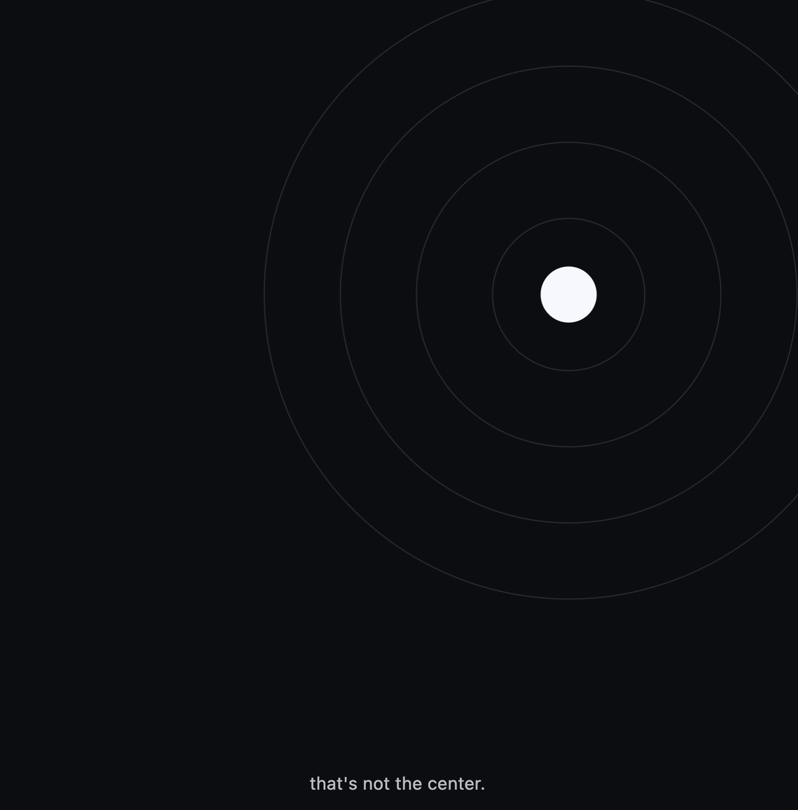

# BuildBrightness

<!-- This README is the front door of your project: the gallery shows its first lines. -->

## what it is

Brightness rings. You hit the center, and as it expands, the brightness goes up.

## what input it collects

Brightness. Instead of a simple slider, you have to set it by hitting the center of the rings while they expand. The more it expands, the brighter it gets.

## screenshot

<!-- drag a screenshot or a gif into this file on github.com to upload it -->

## live

https://<your-github-name>.github.io/<this-repo>/

## how to run it

open `index.html` in a browser. that's it.